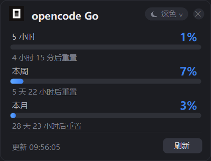
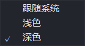
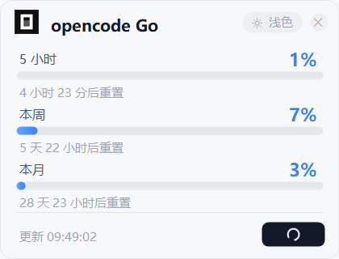

# opencode Go 用量托盘

一个常驻 Windows 托盘的轻量小工具，实时显示 **opencode Go** 套餐三个窗口的用量：5 小时滚动 / 本周 / 本月。

单文件 exe，约 35 KB，只依赖系统自带的 .NET Framework 4.x —— 不需要 Node、Python 或任何运行时。


## 功能

- **托盘常驻**：opencode logo 图标，鼠标悬停直接看数字，左键点一下开/关面板
- **悬浮面板**：无边框、置顶、可拖动；进度条 + 百分比 + 逐秒跳动的重置倒计时
- **深浅色**：下拉框选择「跟随系统 / 浅色 / 深色」，选择会记住；跟随系统时自动跟随 Windows 切换
- **刷新反馈**：点「刷新」按钮转圈，刷新期间忽略重复点击
- **开机自启**：右键菜单一键开关（写 `HKCU\...\Run`）
- 每 30 秒自动刷新一次

| 深色 | 主题下拉 | 刷新中 |
|---|---|---|
|  |  |  |

## 数据来源

调用 opencode 官方用量端点：

```
GET https://opencode.ai/zen/go/v1/usage
Authorization: Bearer <OPENCODE_GO_API_KEY>
```

响应结构：

```json
{
  "usage": {
    "rolling": { "status": "ok", "percent": 1,  "resetsAt": "2026-11-03T06:12:04.000Z" },
    "weekly":  { "status": "ok", "percent": 7,  "resetsAt": "2026-11-09T00:00:00.000Z" },
    "monthly": { "status": "ok", "percent": 35, "resetsAt": "2026-12-02T01:47:28.000Z" }
  }
}
```

`percent` 是**已用**百分比，剩余为 `100 - percent`。

> 该端点只返回百分比，**没有余额金额**。需要看钱请去 opencode 的 billing 页面。

## 密钥与网络

- 密钥：优先读环境变量 `OPENCODE_GO_API_KEY`，否则读 `%USERPROFILE%\.dsh\.credentials.yaml` 里 `refs.OPENCODE_GO_API_KEY`
  （DSH / DeepSeek Harness 用户的密钥就存在那里，所以对这部分用户零配置）
- 网络：优先用 `HTTPS_PROXY` / `HTTP_PROXY` 环境变量指定的代理，其次是 Windows 系统代理；走不通时自动重试直连。两者都失败才报错，并把两边的失败原因都打出来

## 使用

1. 下载 `OpenCodeGoUsage.exe`
2. 双击运行，托盘出现图标，面板默认显示
3. 右键托盘图标可切换主题、开机自启、退出

## 从源码构建

需要 Windows 自带的 C# 编译器（.NET Framework 4.x 已内置，不必装 SDK）：

```bat
build.cmd
```

或手动：

```
%WINDIR%\Microsoft.NET\Framework64\v4.0.30319\csc.exe ^
  /target:winexe /optimize+ /out:OpenCodeGoUsage.exe src\TrayApp.cs ^
  /r:System.dll /r:System.Core.dll /r:System.Drawing.dll ^
  /r:System.Windows.Forms.dll /r:System.Net.Http.dll ^
  /resource:assets\logo.png,OpenCodeGoUsage.logo.png ^
  /win32icon:assets\app.ico
```

`/resource` 把 logo 嵌进程序集，`/win32icon` 给 exe 本身设置图标，两个都不能少。

## 命令行参数

方便调试，正常使用不需要：

| 参数 | 作用 |
|---|---|
| `--probe <file>` | 无界面查询一次，把结果写进文件（排查密钥/网络） |
| `--shot <png> [auto\|light\|dark] [busy]` | 渲染面板截图 |
| `--menushot <png> [auto\|light\|dark]` | 渲染主题下拉菜单截图 |
| `--iconshot <png>` | 渲染多尺寸图标 |

## 排错

异常日志写在 `%TEMP%\opencode-go-usage.log`。

常见情况：

| 现象 | 原因 |
|---|---|
| 面板显示「密钥失效或无 Go 套餐权限」 | key 过期，或该账号没有 Go 套餐 |
| 面板显示「查询失败：…」 | 代理和直连都不通，看冒号后的具体原因 |
| 托盘没有图标 | 程序已在运行（单实例锁），看托盘隐藏区 |

## 已知限制

- 只有百分比，没有金额
- 托盘图标尺寸由 Windows 决定，程序只保证 16px 下清晰
- 仅支持 Windows（WinForms + .NET Framework）

## 许可

MIT，见 [LICENSE](LICENSE)。

程序图标取自 opencode 官网 favicon，仅用于标识所展示的服务，与 opencode 官方无隶属关系。
